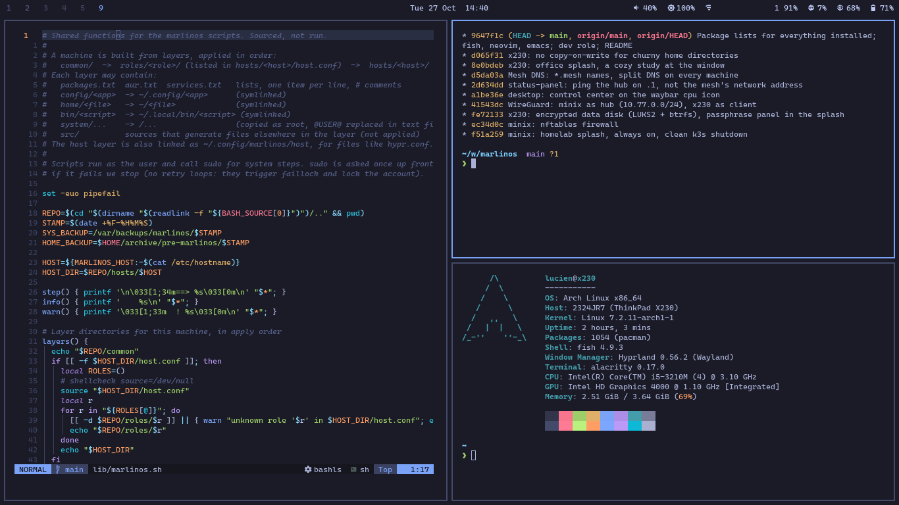
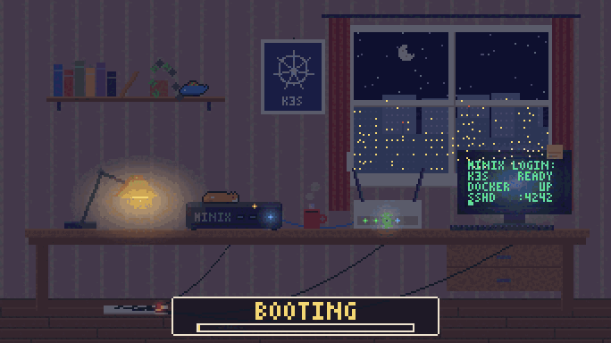
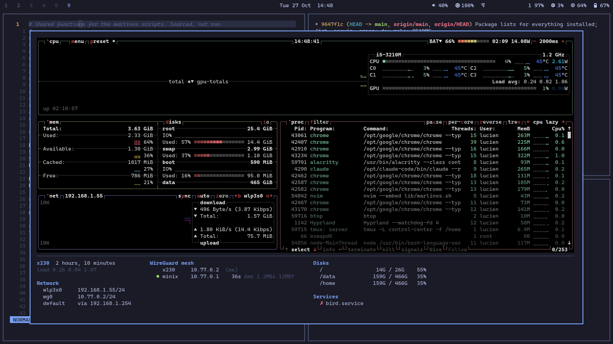
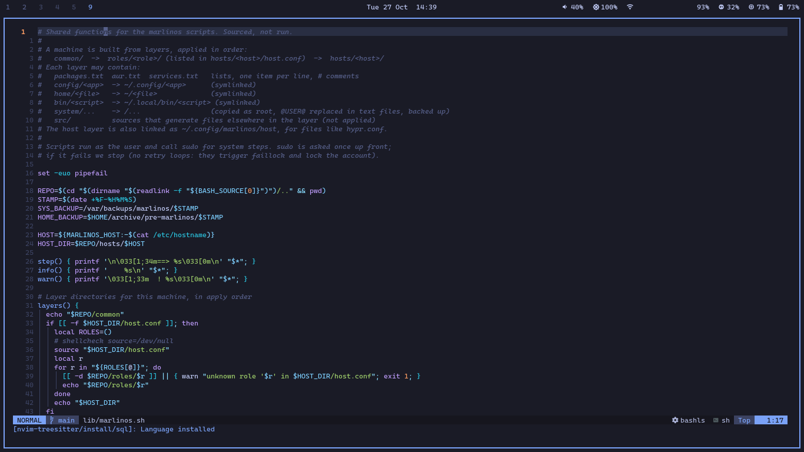

# marlinos

My Arch Linux + Hyprland setup, as a repo: package lists, configs, system files and a few
plain scripts that apply them. The repo is the desired state of each machine; re-running the
install brings a machine back to it. No framework, no foreign package repo, nothing installed
that isn't listed here.

<p align="center">
  
</p>

## Machines

| | |
|---|---|
| **x230** | ThinkPad X230 (2012), the daily laptop. GRUB, encrypted data disk with the passphrase asked in the boot splash. |
| **minix** | Minix Z300 (Intel N100), desktop and home server: docker, k3s, WireGuard hub. Usually headless, managed over ssh. Boots a unified kernel image with systemd-boot. |

Each one draws its own boot splash, in pixel art, generated by a small Python script
(`hosts/<host>/src/`) into a plymouth theme:

<p align="center">
  
  
</p>

## What's in it

- **Hyprland desktop**: waybar, fuzzel, mako, hyprlock/hypridle, Tokyo Night everywhere. One
  Hyprland config file, small enough to read top to bottom.
- **Control center**: click the CPU icon in the bar for btop next to a status panel: addresses,
  the WireGuard mesh (handshake age, ping, traffic per peer), disks, k3s pods, failed services.

  <p align="center"></p>

- **WireGuard mesh** with its own DNS: minix is the hub (10.77.0.0/24), every machine reaches the
  others as `name.mesh`. Split DNS: only `*.mesh` goes through the tunnel; each Wi-Fi keeps its own
  DNS, so captive portals still work.
- **Shell**: fish for typing (autosuggestions, highlighting, completions built in, no plugins),
  bash for scripts and login. Starship prompt.
- **Editors**: Neovim with a lean config (tree-sitter, LSP, fuzzy finding, git signs; ~16 plugins
  pinned by a committed lockfile, language servers from the Arch repos), a built-ins-only Emacs,
  VS Code, and plain vim as a backup.

  <p align="center"></p>

- **Dev role**: Go, Rust (rustup), Node, Python (uv), clang/LLVM, docker. Every toolchain keeps its
  files under the XDG dirs (no `~/.cargo`, `~/go`, `~/.npm` in your home), and `dev-clean` sweeps
  build dirs nobody touched for a month.
- **minix as a server**: an nftables firewall that sits next to docker's and k3s's rules, sshd on a
  custom port with keys only and fail2ban, never suspends, reboots that always finish (k3s pods
  stopped cleanly, a hardware watchdog as the last resort).
- **Firefox** next to Chrome, hardened by a policy file: no telemetry, studies, sponsored content or
  ad measurement; strict tracking protection.

## Layout

A machine is built from layers, applied in order. Layers only add.

```
common/          every machine: shell, command-line tools, network, ssh
roles/desktop/   Hyprland, bar, fonts, audio, printing, apps
roles/dev/       toolchains, language servers, editors, docker
roles/splash/    plymouth (each host brings its own theme)
hosts/<host>/    one machine: hardware packages, system files, its splash, its monitor setup
```

Each layer can have `packages.txt`, `aur.txt`, `services.txt`, `config/` (linked into
`~/.config`), `home/` (dotfiles), `bin/` (scripts, linked into `~/.local/bin`) and `system/` (files
copied into `/` as root, diffed and backed up first). The host is the machine's hostname; its
`host.conf` lists its roles.

## Use

```sh
git clone https://github.com/Marlinski/marlinos ~/work/marlinos
~/work/marlinos/bin/marlinos-install    # packages, system files, services, links; safe to re-run
marlinos-update                         # pull, upgrade, re-apply
marlinos-unlisted                       # installed packages no layer lists: list them or remove them
```

Why things are the way they are: [docs/decisions.md](docs/decisions.md).
